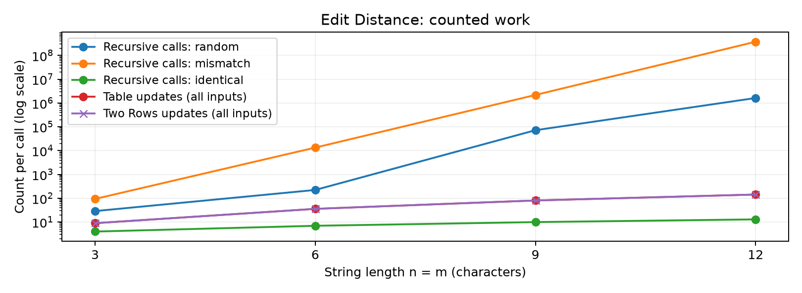
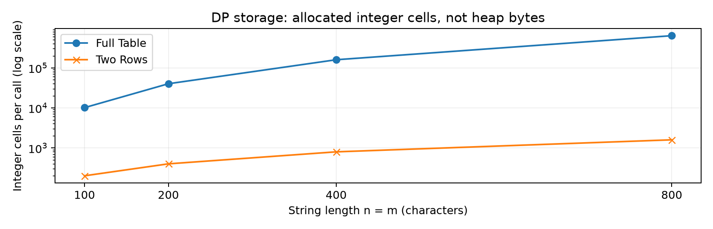
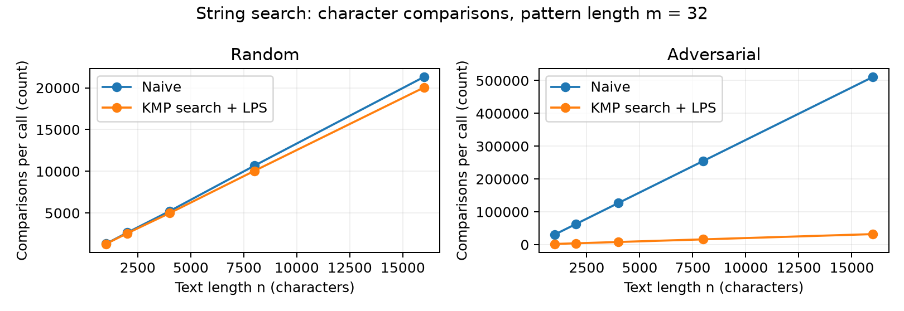

# Assignment 4: Dynamic Programming and String Algorithms

Nurtas Amantay, SE-2525

## 1. Experiment Design Card

This card was written before the first benchmark run. The sizes below replace the suggested recursive sizes before measurement, not after seeing results.

| Field | Edit Distance | String search |
|---|---|---|
| Question | How do plain recursion, a full table and two rows grow with string length? | When and why does KMP use fewer character comparisons than Naive? |
| Sizes (n) | All three: 3, 6, 9, 12, with m = n. Table and Two Rows also: 100, 200, 400, 800. | Text: 1000, 2000, 4000, 8000, 16000. Pattern: m = 32 at every size. |
| Inputs | Random independent strings over ABCD test branching with some matches. Repetitive mismatch A^n vs B^n forces all three recursive branches. Identical A^n vs A^n shows the best recursive path. | Independent random text and pattern over ABCD test early mismatches. Adversarial A^n and A^31B force Naive to check all 32 characters at every valid start. |
| Metrics | Recursive calls, interior DP cell updates, allocated integer cells and median time from 5 trials. Calls and updates are different work units. | Main-search comparisons and separate LPS comparisons; their sum gives total KMP work. Median time includes LPS construction. |
| Prediction | Mismatch recursion grows exponentially; DP updates grow quadratically. Identical recursion takes n+1 calls. Two rows need linear storage, while the table needs quadratic storage. | Random Naive may do fewer comparisons because most starts fail early. KMP should save many comparisons on adversarial input. With fixed m, both search curves are linear in n, with different constants. |
| Plots | Shared-size operation growth on a log axis; allocated DP integer cells at large sizes. | Total comparisons for random and adversarial inputs, including LPS. |

The recursive range is 3 to 12 (4x), replacing the suggested 4 to 16. Full mismatch forces three branches at each non-base call, so the larger size would be too expensive for repeated trials. This is a planned limit, not the largest possible input. The search adversary forces the maximum m comparisons at every valid Naive start.

Seed: 20261105. Each input has a derived seed based on family, type and size. Inputs are generated once and shared by the algorithms. Timing uses System.nanoTime(), 5 measured batches after global and case-specific warm-up, with time divided by the batch size. Generation, validation and CSV writing stay outside timing. Every measured answer is checked. Counter values are per call, not per batch; time may vary between runs.

## 2. Algorithms and Methodology

Recursion compares the last characters without caching. The table stores prefix distances; Two Rows keeps only the previous and current rows. Both DP versions take O(n*m) time for nonempty strings, with O(n*m) and O(m) extra space. Naive checks each valid start. KMP uses the longest proper prefix that is also a suffix (LPS) to reuse matches; the text index never moves backwards. Naive has O(n*m) worst-case search time; KMP has O(n+m) total time.

Counters reset on each call. Recursive calls include base cases; DP updates count interior cells only. Search comparisons count each character equality test, including failures; LPS comparisons are separate. Allocated cells are counted when integer arrays are created, excluding headers, references, output lists and the recursion stack. This is storage in integer cells, not physical heap usage. Zero means no counted operation or a metric that does not apply.

The benchmark uses 500 global warm-up rounds and two warm-up batches per case. Five measured batches follow. Search calls repeat 100 times; distance calls repeat 1-1000 times, as recorded in CSV. Timing includes counters, allocation, method dispatch and answer storage. Measurements use Java 21 on an Intel i5-12450H. All 295 tests passed, including 100 random cases per family.

<!-- pagebreak -->

## 3. Results and Plots

The single results/results.csv contains 80 combinations with five trials each. Plots show per-call counters, which are identical across trials. Reported times are medians of the five measurements. Each type and size uses one seeded input, so the results are not averages over all possible strings.

Figure 1: Mismatch recursion grows from 94 calls at n=3 to 377,393,953 at n=12, while both DP versions grow from 9 to 144 updates and identical recursion needs only 13 calls at n=12.

Calls and updates are different work units, so this chart compares growth, not equal-cost CPU operations. Full mismatch forces three branches at every non-base state and is a worst case for this implementation. Matching characters reduce the tree; the random n=12 case needs 1,633,022 calls. The two DP curves overlap because both compute every interior cell.

Figure 2: At n=m=800, the table allocates 641,601 integer cells and Two Rows allocates 1,602, a 400.5-fold reduction in this storage metric.

Both DP versions still perform 640,000 updates at this size. The counts agree with (n+1)*(m+1) and 2*(m+1), but the plotted numbers come from counters at allocation sites. Values are the same for all three input types because array sizes depend only on the string lengths.

<!-- pagebreak -->

Figure 3: At n=16,000, adversarial Naive uses 511,008 comparisons against KMP's 32,030 including LPS (15.95x fewer), while the random counts are much closer: 21,310 and 20,042.

KMP's adversarial total contains 31,969 search comparisons and 61 LPS comparisons. Naive repeats 32 comparisons at each valid start. Since m stays at 32, both curves grow linearly with n in this experiment; the plot does not claim quadratic growth in n. The generated search cases have no matches; overlap correctness is covered by the unit tests.

Measured time: Mismatch recursion reaches a median of 581.860 ms at n=12, while random n=800 takes 1.943 ms with Table and 0.955 ms with Two Rows.

## 4. Prediction vs Result

Edit Distance: I expected exponential mismatch recursion, quadratic DP work and linear Two Rows storage. These predictions agree with the counters: mismatch recursive calls increase about 172 times from n=9 to 12, whereas DP updates increase from 81 to 144. Identical input confirms that plain recursion is not always slow: it follows one diagonal path. The table and two-row times differ even when their update counts are equal because memory access, allocation and generated machine code also matter.

String search: I expected a large KMP benefit on adversarial input and possible Naive wins on random input. KMP used fewer total comparisons on every sampled random size, so that possible Naive advantage did not appear in the counts. The four-letter alphabet allows partial matches that KMP can reuse, and the fixed LPS cost is small compared with these text lengths. Comparison counts did not always predict time: at random n=16,000, KMP took 0.07661 ms and Naive took 0.05126 ms.

<!-- pagebreak -->

## 5. Short Answers

### Which input made your string search slowest, and why?

The slowest measured search was Naive on adversarial input at n=16,000, with a median of 1.126 ms. The pattern matches 31 A characters and fails on the final B at every valid position. This causes 511,008 repeated comparisons. KMP reuses the matched prefix and takes 0.099 ms including LPS on the same input.

### How large an n could recursive Edit Distance handle, and what stopped it?

The largest tested size was n=m=12, and it completed for all three input types. Full mismatch needed 377,393,953 calls and a median of 0.582 seconds per call to distance. The planned experiment stopped at 12 to keep repeated measurements practical, rather than after a crash or timeout. Larger sizes were not tested, and the limiting concern is repeated branching, not stack depth at these small sizes.

### What do you gain and lose with two rows instead of the full table?

Two Rows reduces additional storage from O(n*m) to O(m) while returning the same distance. At n=m=800 it uses 400.5 times fewer integer cells than the full table. It still performs the same 640,000 interior updates, so its asymptotic running time stays O(n*m). Earlier rows are lost, so a simple backtrace of the edit sequence is unavailable without extra work or a different reconstruction method.

### Which string search would you choose for the city platform, and why?

I would choose KMP for searching long city logs. It handles repeated prefixes without restarting the pattern at every text position, and its O(n+m) bound gives predictable growth. Our adversarial case supports this choice, although KMP had a slower median on random n=16,000. For typo correction in street names, I would use two-row Edit Distance because exact string search does not measure spelling differences.

## 6. Time Analysis

Mismatch recursion ranged from 578.760 to 617.011 ms at n=12; random Table at n=800 ranged from 1.917 to 2.650 ms. The JVM and JIT can change compiled code during execution, while garbage collection, CPU scheduling and other system load affect the clock. Warm-up helps but does not remove these effects: random search time rose sharply between n=8,000 and 16,000. Five trials and their median reduce the effect of one unusual run, but do not prove a general speed ranking. Batching makes short calls measurable; dispatch and answer-storage overhead remain, so tiny differences should not be over-interpreted. Operation counters repeat exactly and explain growth more reliably, while timings show actual cost on this machine. The benchmark runs cases in a fixed order and does not isolate the CPU, which is another limit on timing comparisons.

## 7. Conclusion

These measurements show that DP removes repeated recursive subproblems, and Two Rows saves storage while keeping the answer. KMP greatly reduces repeated comparisons on the chosen hard input, with a much smaller advantage on random text. Correctness tests, reproducible counters and measured medians support these conclusions together; a single timing number would not be enough.
